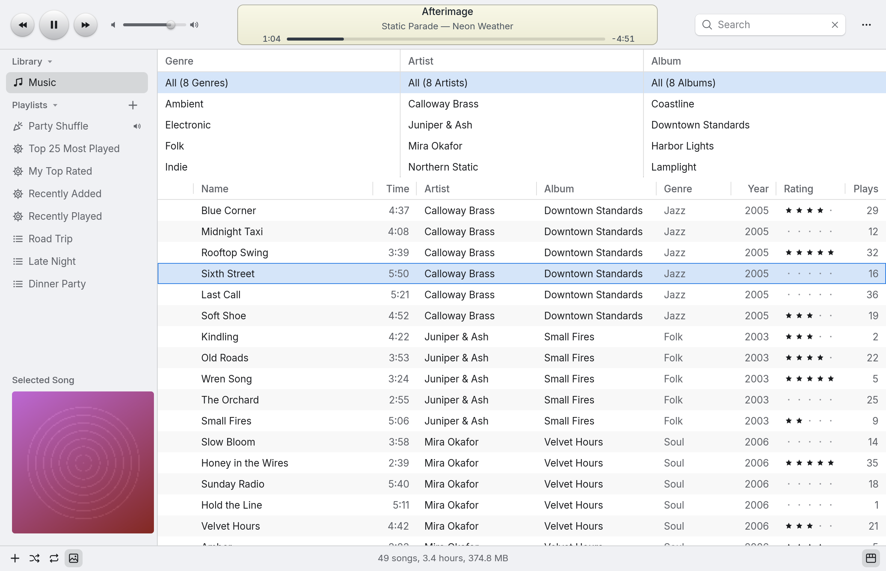
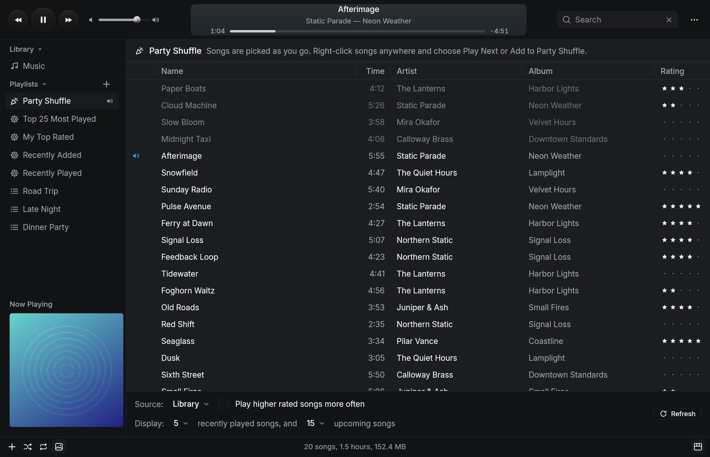

# Stereo

A music player in the spirit of iTunes 4 to 7, Party Shuffle included, drawn with
[Rune](https://github.com/anomalyco/rune), Anomaly's GPU-rendered Rust UI framework.



- **The library**: songs read from your music folders (MP3, FLAC, Ogg Vorbis, Opus, AAC/M4A,
  ALAC, WAV, AIFF), with their tags and artwork, in a sortable, resizable list.
- **The column browser** narrows the list by genre, artist and album; **search** matches every
  word in the title, artist, album or genre.
- **Playlists** you make, rename and fill from a right-click, and **smart playlists**: Top 25
  Most Played, My Top Rated, Recently Added and Recently Played.
- **Ratings and play counts**: click the stars to rate; a song that plays to its end counts a
  play, and one skipped early counts a skip.
- **Shuffle and repeat** (off, all, one), and the song that was playing comes back, paused,
  next time.
- **The LCD** shows the song playing with a scrubber; double-click it to jump to the song.
- **Artwork** of the selected or playing song under the sidebar, looked up on MusicBrainz and
  the Cover Art Archive for albums without any, if you turn that on.
- **Smart playlists of your own**: rules on name, artist, genre, rating, plays, skips, time,
  last played or date added, matched all or any, with a limit ("25 songs by most played").
  More built in: Never Played, Often Skipped, Forgotten Favourites.
- **Up Next**: Play Next and Add to Up Next from a right-click, outside Party Shuffle.
- **Gapless playback, crossfades** (up to 12 seconds), **Sound Check** from ReplayGain tags,
  and a **ten-band equaliser** with iTunes' presets.
- **Get Info**: edit tags and artwork for one song or many; changes are written to the files.
- **Media keys** and the desktop's media controls (MPRIS on Linux), and an optional
  notification when the song changes.
- **Scrobbling** to Last.fm and ListenBrainz.
- **Folders are watched**: new songs join the library by themselves; **Find Missing Files**,
  **Show Duplicates**, **Show in File Manager**, M3U **import and export**, and a **sleep
  timer**.
- **Settings** (Ctrl+,): which columns show, row height, text size, accent colour, how plays
  and skips count, what happens at launch, and the sizes of the built-in smart playlists.

## Party Shuffle



A list that never runs out. It shows a few songs that just played (dimmed), the one playing,
and a set number of upcoming songs picked at random from your library or a playlist. As each
song finishes the list moves up and a new pick joins the bottom.

- **Display**: 0 to 50 recently played songs and 5 to 100 upcoming ones.
- **Play higher rated songs more often** weights the picks by rating (five stars about eleven
  times as often as one; unrated songs count as about three stars).
- Picks avoid what's already upcoming and what played recently, and can lean toward songs
  played less or keep one artist from playing twice in a row.
- **Source**: the library, any playlist, or any smart playlist.
- **Play Next** and **Add to Party Shuffle** from a right-click on songs anywhere; move songs
  with Alt+Up and Alt+Down, take them out with Delete, and **Refresh** picks the upcoming
  songs afresh.
- Double-click a song to play it at once (the ones above it count as played), or a played
  one to hear it again.

```sh
cargo run --release              # or: cargo run --release -- ~/Music
```

## Install

Every [GitHub release](https://github.com/caulifluoride/stereo/releases/latest) has:

- `.deb` for Debian, Ubuntu and derivatives
- `.rpm` for Fedora, openSUSE and derivatives
- `.pkg.tar.zst` for Arch Linux
- an `.AppImage` and a `.flatpak` for any Linux
- a `.tar.gz` with the binary for Linux and macOS, and a `.zip` for Windows

Linux builds are x86_64 and aarch64, macOS builds are Apple silicon and Intel, and Windows is
x86_64. Each snippet installs the latest release, and they are bash: in fish, run them through
`bash -c '…'` or from a bash shell.

<details>
<summary>Debian / Ubuntu (.deb)</summary>

```bash
v=$(curl -fsSL https://api.github.com/repos/caulifluoride/stereo/releases/latest | grep -Po '"tag_name": *"v\K[^"]+')
curl -fLO "https://github.com/caulifluoride/stereo/releases/download/v$v/stereo_${v}_$(dpkg --print-architecture).deb"
sudo apt install "./stereo_${v}_$(dpkg --print-architecture).deb"
```

</details>

<details>
<summary>Fedora / openSUSE (.rpm)</summary>

```bash
v=$(curl -fsSL https://api.github.com/repos/caulifluoride/stereo/releases/latest | grep -Po '"tag_name": *"v\K[^"]+')
curl -fLO "https://github.com/caulifluoride/stereo/releases/download/v$v/stereo-$v-1.$(uname -m).rpm"
sudo dnf install "./stereo-$v-1.$(uname -m).rpm"   # openSUSE: sudo zypper --no-gpg-checks install "./stereo-$v-1.$(uname -m).rpm"
```

</details>

<details>
<summary>Arch Linux (.pkg.tar.zst)</summary>

```bash
v=$(curl -fsSL https://api.github.com/repos/caulifluoride/stereo/releases/latest | grep -Po '"tag_name": *"v\K[^"]+')
curl -fLO "https://github.com/caulifluoride/stereo/releases/download/v$v/stereo-$v-1-$(uname -m).pkg.tar.zst"
sudo pacman -U "./stereo-$v-1-$(uname -m).pkg.tar.zst"
```

</details>

<details>
<summary>AppImage (any Linux)</summary>

It uses the system's ALSA, libxkbcommon, Wayland and Vulkan libraries.

```bash
v=$(curl -fsSL https://api.github.com/repos/caulifluoride/stereo/releases/latest | grep -Po '"tag_name": *"v\K[^"]+')
curl -fL "https://github.com/caulifluoride/stereo/releases/download/v$v/stereo-$v-$(uname -m).AppImage" -o ~/.local/bin/stereo
chmod +x ~/.local/bin/stereo
```

</details>

<details>
<summary>Flatpak (any Linux)</summary>

```bash
v=$(curl -fsSL https://api.github.com/repos/caulifluoride/stereo/releases/latest | grep -Po '"tag_name": *"v\K[^"]+')
curl -fLO "https://github.com/caulifluoride/stereo/releases/download/v$v/stereo-$v-$(uname -m).flatpak"
flatpak install --user -y "./stereo-$v-$(uname -m).flatpak"
flatpak run io.github.caulifluoride.Stereo
```

The sandboxed app keeps its library in `~/.var/app/io.github.caulifluoride.Stereo/data`,
separate from the other installs, and can read your Music folder and folders you pick.

</details>

<details>
<summary>Single binary (Linux)</summary>

```bash
v=$(curl -fsSL https://api.github.com/repos/caulifluoride/stereo/releases/latest | grep -Po '"tag_name": *"v\K[^"]+')
name="stereo-$v-$(uname -m)-unknown-linux-gnu"
curl -fL "https://github.com/caulifluoride/stereo/releases/download/v$v/$name.tar.gz" | tar -xz
install -Dm755 "$name/stereo" ~/.local/bin/stereo
install -Dm644 "$name/stereo.desktop" ~/.local/share/applications/stereo.desktop
install -Dm644 "$name/stereo.svg" ~/.local/share/icons/hicolor/scalable/apps/stereo.svg
rm -rf "$name"
```

</details>

<details>
<summary>macOS</summary>

```bash
v=$(curl -fsSL https://api.github.com/repos/caulifluoride/stereo/releases/latest | grep -Eo '"tag_name": *"v[^"]+' | grep -Eo '[0-9][^"]*')
arch=$(uname -m); [ "$arch" = arm64 ] && arch=aarch64
name="stereo-$v-$arch-apple-darwin"
curl -fL "https://github.com/caulifluoride/stereo/releases/download/v$v/$name.tar.gz" | tar -xz
sudo install -m755 "$name/stereo" /usr/local/bin/stereo
rm -rf "$name"
```

</details>

<details>
<summary>Windows (PowerShell)</summary>

```powershell
$v = (Invoke-RestMethod https://api.github.com/repos/caulifluoride/stereo/releases/latest).tag_name.TrimStart('v')
$name = "stereo-$v-x86_64-pc-windows-msvc"
Invoke-WebRequest "https://github.com/caulifluoride/stereo/releases/download/v$v/$name.zip" -OutFile "$name.zip"
Expand-Archive "$name.zip" -DestinationPath "$env:LOCALAPPDATA\Programs"
Remove-Item "$name.zip"
& "$env:LOCALAPPDATA\Programs\$name\stereo.exe"
```

</details>

<details>
<summary>From source</summary>

Needs [Rust](https://rustup.rs) and [just](https://github.com/casey/just), plus the packages
listed under [Building](#building). It installs into `~/.local`, or into `$PREFIX`.

```bash
git clone https://github.com/caulifluoride/stereo
cd stereo
just install
```

</details>

## Using it

On first launch Stereo scans your Music folder (`XDG_MUSIC_DIR`, else `~/Music`). Add other
folders from the menu at the top right (through the desktop's folder chooser), by dropping
them on the window, or by naming them on the command line; the folders it has scanned are
checked for new songs at each launch. Files stay where they are.

The library, playlists and Party Shuffle are saved as JSON to
`~/.local/share/stereo/library.json` (the platform's data folder elsewhere), or to the file
named by `STEREO_LIBRARY`, a second after a change and when the window closes, off the UI
thread. Settings (theme, volume, shuffle, repeat, panes) go to Rune's `prefs.json`.

| Key | Does |
| --- | --- |
| Space | Play or pause |
| Ctrl+Right / Ctrl+Left | Next / previous song (previous restarts a song past 3 seconds) |
| Ctrl+Up / Ctrl+Down | Volume |
| Return or double-click | Play the selected song |
| Ctrl+1 … Ctrl+5, Ctrl+0 | Rate the selection, or clear its rating |
| Delete | Remove the selection from the playlist or Party Shuffle (or, in Music, from the library) |
| Alt+Up / Alt+Down | Move a Party Shuffle song |
| Ctrl+F, Ctrl+L | Search; go to the song playing |
| Ctrl+N, Ctrl+O | New playlist; add a folder |
| Ctrl+B, Ctrl+G, Ctrl+P | Browser, artwork, Party Shuffle |

On macOS, Cmd takes Ctrl's place.

## Layout

- `src/main.rs`: state, startup, polling and saving.
- `src/control.rs`: playing songs, next and previous, play counts.
- `src/party.rs`: Party Shuffle's list and picks. `src/queue.rs`: shuffle and repeat elsewhere.
- `src/library.rs`: tracks, playlists, tag reading and folder scans. `src/rows.rs`: what the
  list shows (sources, smart playlists, browser, search, sort).
- `src/audio.rs`: the playback thread (rodio and symphonia).
- `src/lcd.rs`, `src/sidebar.rs`, `src/lists.rs`, `src/partyview.rs`, `src/menus.rs`,
  `src/dialogs.rs`, `src/keys.rs`: the window.

Rune plays media through AVFoundation and Media Foundation but has no Linux backend, so Stereo
decodes with symphonia and plays through cpal (by way of rodio) on every platform.

## Checking it headless

Rune apps render without a display. Headless runs show a made-up sample library, play no
sound and never write, unless `STEREO_LIBRARY` is set.

```sh
cargo run -- --snap out.png [--scene party|playlist|menu|shortcuts|no-browser] [--theme dark]
cargo run -- --script clicks.json --tree tree.json --at 2
cargo test                       # library, Party Shuffle, queue, lists
cargo test -- --ignored plays    # plays a generated tone through the sound device
```

## Building

Rust 1.99.1 (pinned in `rust-toolchain.toml`, as Rune pins it). On Linux, Stereo needs the
`alsa`, `libxkbcommon` and `wayland` development packages (`libasound2-dev libxkbcommon-dev
libwayland-dev` on Debian and Ubuntu). Rune is pre-release and is pinned to a rev in
`Cargo.toml`.

## Releases

Pushing a tag like `v0.1.0` runs [`release.yml`](.github/workflows/release.yml), which tests,
builds every binary and package above and attaches them to a GitHub release. Run it by hand
from the Actions tab to build without publishing. The package metadata is in
[`packaging/`](packaging).
